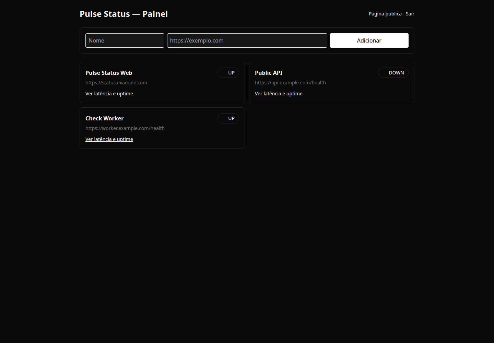
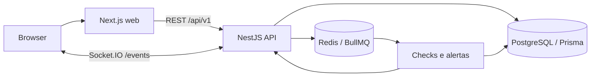

# Pulse Status

Plataforma full stack para acompanhar a disponibilidade de sites e serviços, registrar incidentes e publicar uma página de status.



## Stack

- **Web:** Next.js 14, React e TypeScript (`apps/web`).
- **API:** NestJS, REST e Socket.IO (`apps/api`).
- **Persistência:** PostgreSQL e Prisma (`packages/database/prisma`).
- **Filas:** Redis e BullMQ para verificações e alertas.
- **Desenvolvimento local:** Docker Compose.

## Executar localmente

Requisitos: Node.js 20+, npm 10+ e Docker com Compose.

```bash
cp .env.example .env
```

Revise os segredos `JWT_ACCESS_SECRET` e `JWT_REFRESH_SECRET` no `.env`; use valores aleatórios com pelo menos 32 caracteres. Em seguida:

```bash
npm install
docker compose up --build
```

A web fica em `http://localhost:3000` e a API em `http://localhost:4000/api/v1`. O endpoint de saúde é `GET /api/v1/health`. O Compose inicia PostgreSQL e Redis junto com as aplicações.

Para executar os serviços fora do Docker, configure `DATABASE_URL`, `REDIS_URL`, os dois segredos JWT e `WEB_ORIGIN` no ambiente, aplique as migrações e inicie cada workspace:

```bash
npm run db:migrate --workspace @pulse-status/api
npm run dev --workspace @pulse-status/api
npm run dev --workspace @pulse-status/web
```

`db:migrate` executa as migrações versionadas com `prisma migrate deploy`. Se um banco já foi criado com `prisma db push`, faça backup e confirme que o schema corresponde à migração inicial antes de marcar o baseline:

```bash
npx prisma migrate resolve --applied 20261019000000_init --schema packages/database/prisma/schema.prisma
```

Não execute a migração inicial sobre tabelas existentes sem marcar o baseline.

## Verificações

```bash
npm run format:check
npm run lint
npm test
npm run test:codex
npm run build
```

Os testes de integração usam um banco PostgreSQL descartável. Defina `DATABASE_URL` para esse banco e aplique as migrações antes de `npm run test:codex`. O teste de integração inicia a API em uma porta local efêmera e limpa as contas criadas ao terminar.

## API

Prefixo: `/api/v1`.

| Área           | Rotas principais                                                      |
| -------------- | --------------------------------------------------------------------- |
| Autenticação   | `POST /auth/register`, `/auth/login`, `/auth/refresh`, `/auth/logout` |
| Conta          | `GET /users/me`                                                       |
| Monitores      | `GET                                                                  | POST /monitors`, `GET         | PATCH                       | DELETE /monitors/:id` |
| Histórico      | `GET /monitors/:id/checks`, `GET /monitors/:id/incidents`             |
| Alertas        | `GET                                                                  | POST /alert-channels`, `PATCH | DELETE /alert-channels/:id` |
| Status público | `GET /status/:id`                                                     |
| Saúde          | `GET /health`                                                         |

Eventos de mudança de estado são publicados no namespace Socket.IO `/events`. IDs de monitores privados são isolados por usuário; a página pública só expõe monitores marcados como públicos.

## Arquitetura



## Estado do MVP

- Autenticação, gestão de monitores, histórico e páginas públicas estão implementados.
- Verificações recorrentes e envio real de e-mail dependem de configuração operacional de workers e transporte SMTP.
- Configure provedores de e-mail e canais de alerta antes de depender de notificações em produção.
- Antes do deploy, defina provedor, domínio, variáveis e políticas de backup/retensão. Não use os valores ilustrativos do `.env.example` em produção.

## Licença

Ainda não definida.
